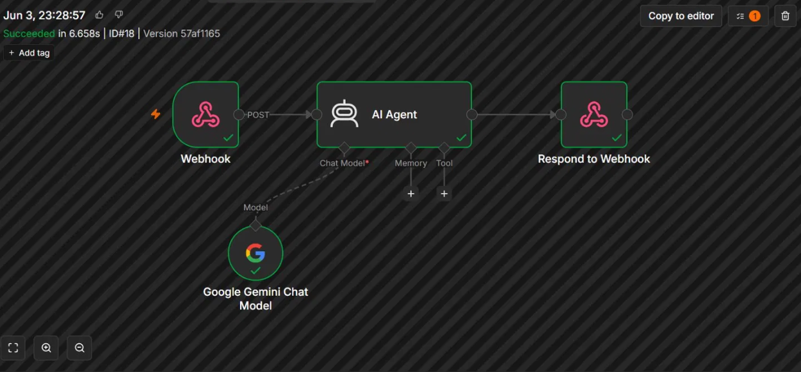
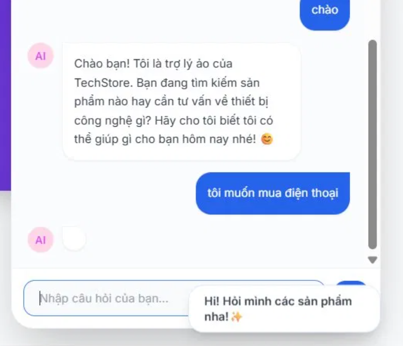

# AI Workflow Automation - Trợ lý ảo TechStore

## 📌 Tổng quan Hệ thống
Dự án tích hợp Trí tuệ nhân tạo vào giao diện chăm sóc khách hàng, sử dụng nền tảng n8n để tự động hóa luồng xử lý dữ liệu giữa Frontend và AI Model.

## ⚙️ Kiến trúc Tích hợp (Integration Architecture)
- **API Gateway & Routing:** Thiết lập node `Webhook` để mở cổng (POST) nhận tín hiệu và dữ liệu đầu vào từ giao diện chat của người dùng.
- **AI Processing:** Cấu hình `AI Agent` kết nối trực tiếp với `Google Gemini Chat Model` qua API key, cung cấp context (bối cảnh) để AI đóng vai trò là nhân viên tư vấn của TechStore.
- **Response Handling:** Sử dụng node `Respond to Webhook` để định dạng kết quả từ AI và trả về giao diện Frontend theo thời gian thực (Real-time).

## 💡 Lưu ý về Triển khai (Deployment Note)
- Mã nguồn Frontend (HTML/CSS/JS) được đính kèm trong repository này để tham khảo.
- Hệ thống xử lý Backend (n8n Webhook & AI API) hiện đang được tạm ngưng (spun down) khỏi môi trường thực tế để tối ưu chi phí hạ tầng mạng. Kết quả xử lý thực tế được minh họa qua hình ảnh Frontend bên trên.
